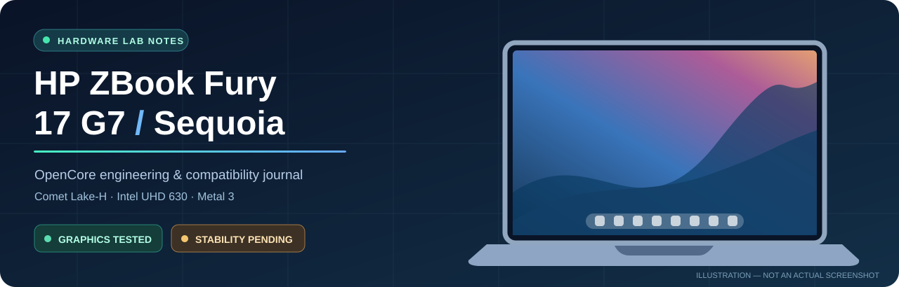
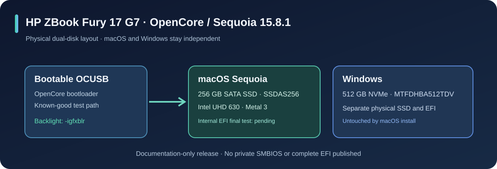

# تشغيل macOS Sequoia على HP ZBook Fury 17 G7

**تجربة فعلية موثقة، من شاشة سوداء إلى تسريع Metal 3 وإضاءة قابلة للتحكم.**

**[English](README.md)** · **[التوافق](docs/02-WHAT-WORKS.md)** · **[إصلاح الإضاءة](docs/03-GRAPHICS-BACKLIGHT-FIX.md)** · **[أوامر التشخيص](docs/08-DIAGNOSTICS.md)**

---

> [!IMPORTANT]
> **تحديث 30 أكتوبر 2026:** الماك اشتغل على جهازنا بالرسوميات المدمجة وتسريع **Metal 3**، والواي فاي والسماعات الداخلية. تجربة `-igfxblr` نجحت في إضاءة الشاشة والتحكم الفعلي في السطوع؛ لكن **الثبات بعد إقلاعات متكررة وSleep/Wake لسه ما اتأكدش**.
>
> ويندوز على SSD NVMe منفصل **512GB**، والماك على SATA SSD **256GB**. ملفات EFI النهائية **مش منشورة** لحد ما نتأكد من الاختبارات ونحذف بيانات SMBIOS الخاصة.

## روابط التحميل الأصلية والسكريبتات والدعم

> **دي الروابط الحقيقية من سجل تحميل ويندوز عندنا، مش روابط تخمينية.** قارنا اسم الصورة وحجمها وبصمة SHA-256 مع بيانات GitHub Actions الأصلية.

| المطلوب | الرابط |
| --- | --- |
| **صاحب مشروع إنشاء نسخة الماك** | **[Tieu Long / LongQT-sea — macos-iso-builder](https://github.com/LongQT-sea/macos-iso-builder)** |
| **رابط نسخة الماك التي استخدمناها بالفعل** | **[macOS Sequoia 15.8.1 — GitHub Actions Artifact](https://github.com/Leo213github08/macos-iso-builder/actions/runs/40181607639/artifacts/12594984907)** |
| **بصمة الملف** | `1e288befa2e851ece653850cecaf06de8e808e1376b13cf20fc5768699ba146e` |
| **طريقة التحميل أو بناء صورة جديدة بعد انتهاء الرابط** | **[شرح المصدر الأصلي بالتفصيل](docs/10-INSTALLER-SOURCE.md)** |
| **السكريبتات التي استُخدمت وأدوات التشخيص** | **[مكتبة السكريبتات](docs/12-SCRIPTS.md)** |
| **عندك مشكلة؟** | **[افتح Bug Report هنا](https://github.com/Mahmoud-Shabana/HP-ZBook-Fury-17-G7-OpenCore-Sequoia/issues/new?template=bug-report.yml)** |

**تنبيه:** رابط تحميل نسخة الماك الحالي مسجّل إنه ينتهي **9 نوفمبر 2026**؛ وقد يحتاج تسجيل الدخول إلى GitHub. عشان كده شرحنا طريقة إنشاء ملف جديد بأداة صاحب المشروع بدل وضع روابط تحميل مؤقتة أو نسخ غير موثوقة.

**لو واجهتك مشكلة في شاشة الباسورد أو الإضاءة أو تعريفات الجهاز، افتح Bug Report**، وصاحب المستودع هيتابع ويردّ على البلاغات **حسب الوقت المتاح**. [اقرأ طريقة الإبلاغ عن الأخطاء](docs/11-BUG-REPORTS-AND-SUPPORT.md).

## المواصفات المؤكدة

| القطعة | التفاصيل |
| --- | --- |
| الجهاز | **HP ZBook Fury 17 G7** |
| المعالج | Intel **i7-10850H**، ست أنوية و12 مسارًا |
| الرسوميات | Intel UHD 630 — **8086:9BC4**، تسريع Metal 3 |
| NVIDIA | Quadro RTX 3000 6GB، غير مستخدم في الماك |
| الشاشة | LG Display **LGD063F**، 1920×1080 / 60Hz |
| الرام | **16GB** |
| الواي فاي | **Intel AX201** — 8086:06F0 |
| الصوت | **Realtek ALC285**، AppleALC layout 33 |
| BIOS | HP S92 **01.25.00**، وضع UMA |
| macOS | **Sequoia 15.8.1 (24H32)** |
| التخزين | **256GB SATA للماك** + **512GB NVMe لويندوز** |
| SMBIOS | MacBookPro16,1، بدون نشر أرقام خاصة |

## توافق المكونات

| الخاصية | النتيجة | الملاحظة |
| --- | :---: | --- |
| الإقلاع من OCUSB | ✅ | سطح المكتب اشتغل |
| Intel UHD 630 | ✅ | Metal 3، ذاكرة عرض 1536MB |
| الدقة الأصلية | ✅ | 1920×1080 / 60Hz |
| Wi-Fi والسماعات | ✅ | اشتغلوا فعليًا |
| شريط السطوع | ✅ | زوّد وقلّل نور الشاشة مع `-igfxblr` |
| إضاءة ثابتة من أول البوت | 🟡 | محتاج إعادة اختبار متكرر |
| حرارة المعالج والمراوح | 🟠 | محتاج قياسات حقيقية |
| البطارية والبلوتوث والتاتش باد والكاميرا | ⚪ | لم تُختبر بالكامل |
| إقلاع SSD بدون الفلاشة | 🟠 | النسخة النهائية لم تُختبر عليه |
| الميكروفون الداخلي | ➖ | غير مطلوب |

## اكتشاف وحل مشكلة الشاشة السوداء

شعار Apple وشريط التحميل كانا بيظهروا بإضاءة طبيعية، وبعدها الشاشة تسود. **الكشاف أظهر شاشة الباسورد وأيقونات Dock** — يعني الماك شغال والصورة موجودة، لكن الإضاءة الخلفية اختفت.

بعد تجارب متعددة وإصلاح إعدادات توقيت الشاشة والـDPCD، اشتغل **Metal 3** لكن الإضاءة فضلت متقطعة. لما استبدلنا خيار WhateverGreen القديم **`-igfxblt`** بـ **`-igfxblr`** ظهرت الإضاءة، وقدرنا نزود ونقلل السطوع فعلًا من إعدادات Displays.

~~~text
keepsyms=1 debug=0x100 -wegnoegpu -igfxblr igfxonln=1
~~~

**الحكم العلمي:** نجاح فعلي في جلسة واحدة، مش ضمان إن المشكلة اتحلت للأبد. لازم اختبارات Restart وCold Boot وSleep/Wake.

[القصة التقنية الكاملة مع الإعدادات التي نجحت والتي فشلت](docs/03-GRAPHICS-BACKLIGHT-FIX.md).

## مخطط أقراص النظام

القاعدة الأساسية: **لا تلمس EFI الخاص بويندوز**. وملف OpenCore الموجود على SATA الداخلي أقدم من التعديلات النهائية؛ لذلك لا ندّعي إن الإقلاع من غير فلاشة اتحسم.

## ماذا عن السخونة؟

تقرير القياس أظهر **84.24% CPU idle** و**2.61W تقديري لحزمة المعالج** وظهور `X86PlatformPlugin` نشطًا. لكنه **لم يُظهر درجة حرارة المعالج ولا RPM المراوح** بسبب أخطاء SMC. لذلك لا نستطيع اعتبار السخونة محلولة من التقرير الحالي.

[التحليل الحراري](docs/04-POWER-THERMALS.md) · [تشخيص آمن للقراءة فقط](docs/08-DIAGNOSTICS.md).

## خريطة الطريق

- [ ] اختبار الإضاءة بعد **3 عمليات Restart ومرتين Cold Boot**.
- [ ] اختبار Sleep/Wake وفتح/قفل الغطاء.
- [ ] قراءة حرارة CPU الحقيقية والمراوح وحالة NVIDIA والبطارية.
- [ ] اختبار الكاميرا والبلوتوث والتاتش باد والمنافذ.
- [ ] نقل نسخة OpenCore النهائية لقرص الماك **256GB SATA** فقط.
- [ ] التأكد من الإقلاع **بدون الفلاشة**.
- [ ] مراجعة الخصوصية وحذف السيريال وMLB وROM وSystemUUID قبل إصدار EFI عام.

[متابعة الشاشة والإقلاع #1](../../issues/1) · [متابعة الحرارة والقطع #2](../../issues/2).

## توثيق المشروع

[مواصفات الجهاز](docs/01-HARDWARE.md) · [جدول التوافق](docs/02-WHAT-WORKS.md) · [التجارب الرسومية](docs/03-GRAPHICS-BACKLIGHT-FIX.md) · [البطارية والحرارة](docs/04-POWER-THERMALS.md) · [الاختبارات المتبقية](docs/05-NEXT-STEPS.md) · [قواعد الخصوصية](SECURITY.md).

المشروع للتوثيق والمشاركة الفنية، وليس نسخة macOS أو EFI مضمون لكل الأجهزة. الاستفادة من توثيق [Dortania](https://dortania.github.io/OpenCore-Install-Guide/) و[WhateverGreen](https://github.com/acidanthera/WhateverGreen)، والنتائج تخص **نفس الجهاز بهذه المواصفات**.
