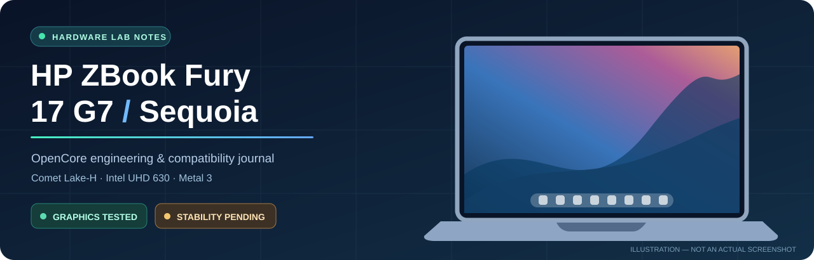
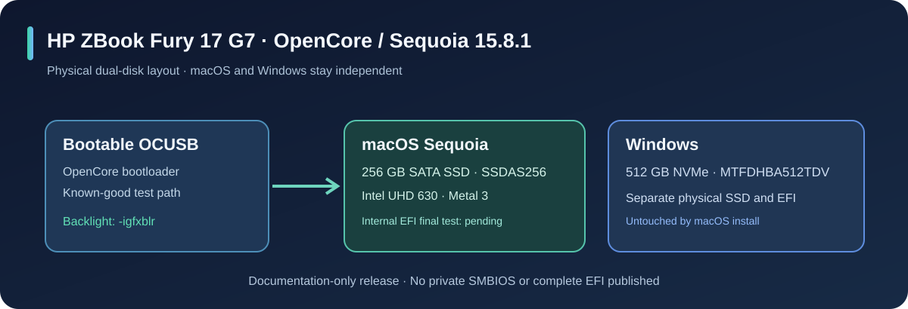

# HP ZBook Fury 17 G7 · OpenCore Sequoia

**An evidence-led Hackintosh engineering journal. Real hardware, reproducible findings, no private EFI leaks.**

**[العربية — Read in Arabic](README.ar.md)** · **[Compatibility](docs/02-WHAT-WORKS.md)** · **[Display fix](docs/03-GRAPHICS-BACKLIGHT-FIX.md)** · **[Diagnostics](docs/08-DIAGNOSTICS.md)** · **[Roadmap](docs/05-NEXT-STEPS.md)**

---

> [!IMPORTANT]
> **Status: 30 October 2026.** macOS Sequoia 15.8.1 is usable on the HP ZBook Fury 17 G7 with **Metal 3 accelerated Intel graphics, Wi-Fi and speakers**. Replacing WhateverGreen `-igfxblt` with `-igfxblr` was followed by a working physical brightness slider in a real test. **Repeated cold boots, sleep/wake, cooling and standalone SSD boot are not yet fully verified.**
>
> **There is no ready-to-flash EFI release.** Never use another machine's SMBIOS identifiers or overwrite the independent Windows NVMe EFI.

## Hardware / verified configuration

| Area | Actual hardware | Observed configuration |
| :-- | :-- | :-- |
| Machine | **HP ZBook Fury 17 G7** | BIOS S92 **01.25.00**, UMA graphics |
| CPU | Intel **Core i7-10850H** | Comet Lake-H, 6 cores / 12 threads |
| iGPU | Intel **UHD Graphics 630** | PCI **8086:9BC4**, **Metal 3**, 1536 MB VRAM |
| dGPU | NVIDIA Quadro RTX 3000 6 GB | Not used for acceleration; power state unverified |
| Display | **LGD063F** | Built-in **1920 × 1080, 60 Hz** |
| Wi-Fi | Intel AX201 | **8086:06F0**, AirportItlwm 2.4.0 |
| Audio | Realtek ALC285 | **10EC:0285**, AppleALC layout **33**, speakers work |
| Memory | 16 GB | macOS sees full capacity |
| macOS drive | **SSDAS256 SATA**, 256 GB | Separate physical SSD |
| Windows drive | **MTFDHBA512TDV NVMe**, 512 GB | Separate EFI, must remain untouched |
| macOS | **Sequoia 15.8.1 (24H32)** | SMBIOS model MacBookPro16,1; private IDs omitted |

<strong>Kernel extensions observed in the positive session</strong>

| Kext | Version |
| --- | --- |
| Lilu | 1.7.2 |
| WhateverGreen | 1.7.1 |
| VirtualSMC | 1.3.8 |
| AppleALC | 1.9.8 |
| AirportItlwm | 2.4.0 |
| USBToolBox | 1.2.0 |

This is a verified observation, not necessarily a complete working EFI inventory.

## Compatibility at a glance

| Feature | State | What we actually verified |
| --- | :---: | --- |
| Boot with OCUSB | ✅ | macOS reaches desktop |
| GPU acceleration | ✅ | Intel UHD 630, Metal 3, 1536 MB |
| Built-in 1080p screen | ✅ | Native resolution and 60 Hz |
| Wi-Fi and speakers | ✅ | Connected network and audible output |
| Backlight brightness slider | ✅¹ | Physically brightened and dimmed panel with `-igfxblr` |
| Reliable backlight over multiple starts | 🟡 | **Still needs repeated tests** |
| CPU power management | 🟡 | X86PlatformPlugin loaded; thermals not proven |
| Battery, fans, sensors | 🟠 | Not fully operational/verified |
| Bluetooth, camera, trackpad, sleep | ⚪ | Awaiting end-to-end tests |
| Boot from internal SATA without USB | 🟠 | Final EFI not yet verified internally |
| Built-in microphone | ➖ | Explicitly out of scope |

¹ A positive test is not a permanent-fix guarantee. Full [compatibility matrix](docs/02-WHAT-WORKS.md).

## Case study · When the screen is black but macOS has booted

The Apple logo and loading bar were **illuminated**. The screen then went black — but shining a flashlight onto it revealed the **login form and Dock**. Audio and keyboard were still responding. That distinguishes a **failed LCD backlight** from a missing framebuffer image.

| Iteration | Observed result |
| --- | --- |
| Legacy VESA fallback | Desktop visible, ~7 MB VRAM, **no Metal** |
| Native Intel acceleration without correct display timing | Black screen or panic during some attempts |
| DPCD limit + panel EDID + framebuffer properties | **Full Metal 3** at 1920 × 1080 |
| `igfxonln=1` | Apple logo visibly improved; login backlight still intermittent |
| PNLF changes plus `-igfxblt` | Black login screen persisted |
| **Substitute `-igfxblr`** | **Positive test**: illuminated desktop and working brightness slider |

**Boot arguments observed on the successful session:**

~~~text
keepsyms=1 debug=0x100 -wegnoegpu -igfxblr igfxonln=1
~~~

<strong>Expand the verified Intel framebuffer values (not a complete EFI)</strong>

~~~text
DeviceProperties / Add / PciRoot(0x0)/Pci(0x2,0x0)
AAPL,ig-platform-id                  00009b3e
framebuffer-patch-enable             01000000
framebuffer-stolenmem                00003001
framebuffer-fbmem                    00009000
enable-dpcd-max-link-rate-fix        01000000
dpcd-max-link-rate                   0a000000
AAPL00,override-no-connect           [LGD063F-specific EDID omitted]
~~~

The EDID and framebuffer values are panel-specific; do not transplant blindly. See the [non-bootable example](examples/graphics-boot-settings.json).

> [!NOTE]
> [WhateverGreen](https://github.com/acidanthera/WhateverGreen/blob/master/README.md) defines **`-igfxblr`** as its Backlight Registers Fix and **`-igfxblt`** as the Alternative Fix. Its [backlight FAQ](https://github.com/acidanthera/WhateverGreen/blob/master/Manual/FAQ.IntelHD.en.md) documents the difference and caveats on modern macOS. **Our observed result is specific to this exact setup.**

**[Explore the full diagnosis, failures, corrections and acceptance checks →](docs/03-GRAPHICS-BACKLIGHT-FIX.md)**

## Why the two drives matter

The **known-good USB** is the current reference. The internal SSD received an older EFI, but it has **not yet been independently verified with the final `-igfxblr` configuration**. [Safe internal EFI protocol](docs/06-INTERNAL-EFI.md).

## Evidence, not assumptions

| Audit item | Actual observation | Limitation |
| --- | --- | --- |
| CPU package estimate | **2.61 W** sample | Not total laptop consumption or CPU temperature |
| CPU idle snapshot | **84.24%** | Does not prove cool operation under workload |
| X86PlatformPlugin | Active | Power optimization not fully characterized |
| Thermal pressure | Nominal in sample | Not a full thermal evaluation |
| SMC sensors | Repeated *Invalid key detected!* | **No real CPU temperature / fan RPM obtained** |
| AppleBacklightDisplay | Active after bright boot | Cold-boot reliability still to be tested |

[Read the measured thermal report](docs/04-POWER-THERMALS.md) · [Run read-only diagnostics](docs/08-DIAGNOSTICS.md).

## Documentation index

| Guide | What's inside |
| --- | --- |
| [Hardware inventory](docs/01-HARDWARE.md) | Panel, CPU, PCI IDs, physical disks and BIOS |
| [Compatibility matrix](docs/02-WHAT-WORKS.md) | **Tested / partial / untested**, no inflated claims |
| [Backlight deep dive](docs/03-GRAPHICS-BACKLIGHT-FIX.md) | Flashlight discovery, `-igfxblr` and unsuccessful variants |
| [Power and thermals](docs/04-POWER-THERMALS.md) | What the audit can and cannot prove |
| [Release gates](docs/05-NEXT-STEPS.md) | Tests needed for everyday stability |
| [Internal EFI safety](docs/06-INTERNAL-EFI.md) | SATA-only verification; protect Windows |
| [Privacy policy](docs/07-PRIVACY-BEFORE-PUBLISHING.md) | Never leak personal SMBIOS data |
| [Diagnostics](docs/08-DIAGNOSTICS.md) | Reproducible, read-only commands |
| [FAQ](docs/09-FAQ.md) | Symptoms, hardware differences and next steps |

## Release roadmap

- [ ] Verify backlight at **3 restarts + 2 cold boots**, without flashlight.
- [ ] Verify lid sleep/wake, display brightness and network recovery.
- [ ] Measure **actual** CPU temperature, fan activity and dGPU power state.
- [ ] Test battery, Bluetooth, trackpad, webcam and ports.
- [ ] Copy **exact final USB EFI** to the macOS SATA SSD after backup.
- [ ] Boot with **USB disconnected**; keep Windows NVMe untouched.
- [ ] Review and sanitize every binary and identifier before any public EFI release.

[**Display + boot milestone #1**](../../issues/1) · [**Thermals + peripherals #2**](../../issues/2).

## Contributing & acknowledgements

This is a research diary for **one real HP workstation**, not a universal EFI. See [CONTRIBUTING](CONTRIBUTING.md), [SECURITY](SECURITY.md) and [CHANGELOG](CHANGELOG.md). Thanks to the [Dortania OpenCore guides](https://dortania.github.io/OpenCore-Install-Guide/), [WhateverGreen](https://github.com/acidanthera/WhateverGreen), [VirtualSMC](https://github.com/acidanthera/VirtualSMC) and the wider Hackintosh community.

No Apple installers, macOS images, Apple proprietary binaries, private firmware dumps, or live SMBIOS identifiers are included. Check the applicable macOS license terms.

Evidence last updated 30 October 2026 · Made for accurate reproducibility, not a misleading "100% working" claim.

